# Deck Build Guide — Week 8 Presentation

**The one document to open if you're building the slides.**

Self-contained: every visual is previewed inline, every linked
asset uses a relative path so the links work as soon as you have
this folder checked out at the same place.

- Talk length: **6 min + 3 min Q&A**, hard stop at 7 min.
- Slides: **9 core + 1 optional** (5b Pareto).
- Build all assets from scratch: see [§ Build commands](#build-commands) at the bottom.

If you just want the speaker script (no visuals, no tables),
open [`OUTLINE.md`](./OUTLINE.md).  If you want the asset
inventory (no slides), open [`INDEX.md`](./INDEX.md).

---

## Table of contents

1. [Slide 1 — Title](#slide-1--title-10-s)
2. [Slide 2 — Motivation](#slide-2--motivation-45-s)
3. [Slide 3 — Problem formulation](#slide-3--problem-formulation-50-s)
4. [Slide 4 — Method & baselines](#slide-4--method--baselines-60-s)
5. [Slide 5 — Cross-task results](#slide-5--cross-task-results-70-s)
6. [Slide 5b — Cost-vs-performance Pareto *(optional)*](#slide-5b--cost-vs-performance-pareto-optional-30-s)
7. [Slide 6 — Two GREEN cells](#slide-6--two-green-cells-80-s)
8. [Slide 7 — Adaptation scaling law](#slide-7--adaptation-scaling-law-45-s)
9. [Slide 8 — Lessons + what didn't work](#slide-8--lessons--what-didnt-work-50-s)
10. [Slide 9 — Conclusions + Future work](#slide-9--conclusions--future-work-40-s)
11. [Build commands](#build-commands)
12. [Style guide](#style-guide)
13. [Pre-flight checklist](#pre-flight-checklist)

---

## Slide 1 — Title (10 s)

**Title bar:**
> Hybrid Robot Trajectory Generation
> *Learned demonstration priors meet model-based diffusion*

**Authors:** Zihao Sun · Charles Beck — ECE M237, Spring 2026.

**Background loop (optional):** Use the Can rollout faded to 30 %
opacity.

[▶ best_rollout_can.mp4](./videos/best_rollout_can.mp4)
(435 KB, 4 s).

**Script (~10 s):**
> "We're Zihao and Charles.  Our project combines a learned demo
> prior with model-based diffusion in a single denoising loop."

---

## Slide 2 — Motivation (45 s)

**Title bar:**
> Why combine learned priors and model-based diffusion?

**3-up video panel.** Three rollouts in a row to show "BC drifts,
MBD chaotic, hybrid clean":

| left: BC-like | middle: MBD ensemble cloud | right: hybrid success |
|---|---|---|
| [▶ best_rollout_lift.mp4](./videos/best_rollout_lift.mp4) | [▶ trajectory_on_env_can.mp4](./videos/trajectory_on_env_can.mp4) | [▶ best_rollout_can.mp4](./videos/best_rollout_can.mp4) |

The middle clip is the **headline asset** of this talk — a
playhead reveal of 12 candidate end-effector trajectories
(faded blue) + the optimal demo (red) overlaid on the env.

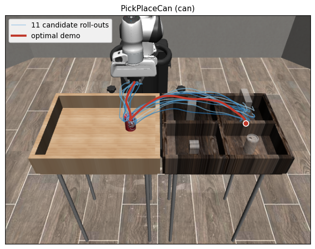

**Numerical contrast (one table on the slide):**

| Method | Can/ph success | Source |
|---|---:|---|
| BC alone | 6.7 % (4 / 60) | exp 03 baseline |
| MBD alone | 0.0 % (0 / 60) | exp 04 baseline |
| **Hybrid (best cell)** | **86.7 %** (26 / 30) | Phase F ep0149 K=10 λ=2.0 |

**Question on the slide (one line):**
> "Can a learned prior *rescue* a model-based planner — and does
> the cost still get to add anything?"

**Script (~45 s):**
> "Two failure modes.  Behaviour cloning gives a smooth policy
> but doesn't recover from drift — 7 % on Can.  Model-based
> diffusion has a cost it can re-evaluate, but with random init
> over 120 steps it's unsearchable — 0 %.  The interesting
> question: compose them.  This middle video is the cloud of
> candidates MBD has to pick from; the red line is the optimal."

---

## Slide 3 — Problem formulation (50 s)

**Title bar:**
> Composite score: blend the learned and analytical gradients

**Equation (paste into Beamer or LaTeXiT — *not* matplotlib mathtext):**

```latex
\nabla \log p_t(\tau)
  \;\approx\;
  \underbrace{\nabla \log p^{\mathrm{model}}_t(\tau)}_{\text{MBD cost}}
  \;+\;
  \lambda(\sigma_t)\,
  \underbrace{\nabla \log p^{\mathrm{data}}_t(\tau)}_{\text{learned prior}}
\,,\quad
p^{\mathrm{model}}(\tau)
  \propto
  \exp\!\bigl(-J(\tau)/\beta\bigr).
```

**Symbol legend (below the equation):**

| Symbol | Means | Source |
|---|---|---|
| $p^{\mathrm{data}}$ | learned trajectory distribution | BC / flow / retrieval / DP |
| $J(\tau)$ | hand-designed cost | goal-distance + contact + grip |
| $\lambda(\sigma_t)$ | noise-scheduled blend | $\lambda=0$ → MBD; $\lambda\to\infty$ → prior-only |

**Script (~50 s):**
> "Replace the score in the denoising chain with a *composite*
> of two.  Lambda controls the mix — zero recovers MBD, infinity
> recovers pure prior denoising, and the interesting region is
> in between."

---

## Slide 4 — Method & baselines (60 s)

**Title bar:**
> One update rule, four prior families

**Main visual (top half of slide):**

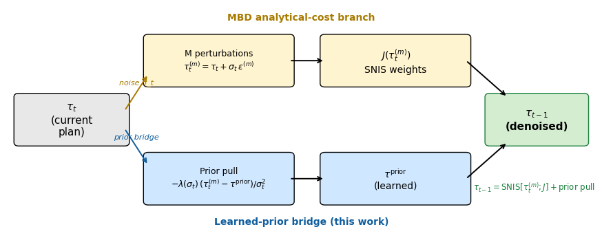

[high-res PDF](./figures/method_architecture.pdf)

The **yellow branch** is the analytical-cost path (perturbations
→ cost → SNIS weights); the **blue branch** is the learned-prior
bridge (pull toward $\tau^{\rm prior}$).  Both flow into the
same $\tau_{t-1}$ update step on the right.

**Comparison table (bottom half of slide):**

| Prior family | Train wall | Params | Alone @ Can | + MBD bridge |
|---|---:|---:|---:|---:|
| MBD-alone (no prior) | 0 s | 0 | 0.000 | — |
| Warm-start ablation | — | — | 0.017 | — |
| **Retrieval (1-NN, 0-train)** | ~5 s¹ | 0 | n/a | **0.738** |
| BC (MLP, exp 03) | 72 s | 80 k | 0.067 | (no lift seen) |
| Flow-matching (CFM v6) | ~30 min² | 82.7 M | 0.560 | 0.700 ⁴ |
| **Trained DP-v3b @ ep0149** | 17 min | 63.6 M | 0.733 | **0.867** ³ |

¹ Bank-load only; the "training" is `argmin ‖obs − bank_obs[i]‖`.
² Approximate; flow training logs carry per-epoch loss, no wall.
³ Phase F cheapest-path GREEN cell at (ep0149, K=10, λ=2.0).
  DP standalone on the fresh 50-seed bucket (ep0199) = 76 % (38/50),
  consistent with 73.3 % within noise.
⁴ CFM v6 (`v_theta_v6_unet_xl`): 28/50 standalone, 21/30 +bridge at
  λ=2.0.  The earlier EDM σ-specialist v3 is non-functional (0 %,
  reproduced across every eval) and is excluded.

**Script (~60 s):**
> "Every MBD iteration: M perturbations, cost-weighted SNIS,
> *plus* a Gaussian pull toward the prior.  Four prior families
> share the same update rule — the second half is the wall-clock
> cost of each.  Retrieval is **zero-training** — five seconds
> gives you 73.8 %.  Beating it takes 17 minutes of DP training
> *and* the MBD bridge."

---

## Slide 5 — Cross-task results (70 s)

**Title bar:**
> Cross-task headline: zero-training retrieval, with trained-DP reference

**Layout — 2×2 grid (top-left = bar chart, other three = task ensembles):**

|  |  |
|---|---|
| 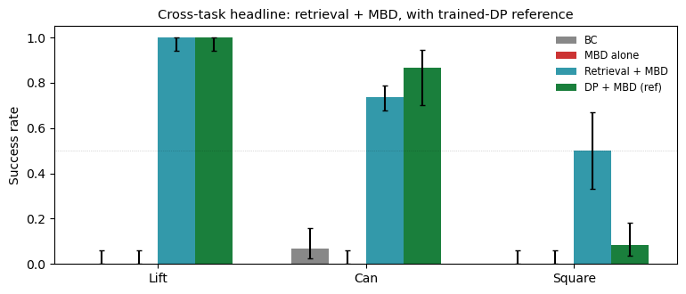 | 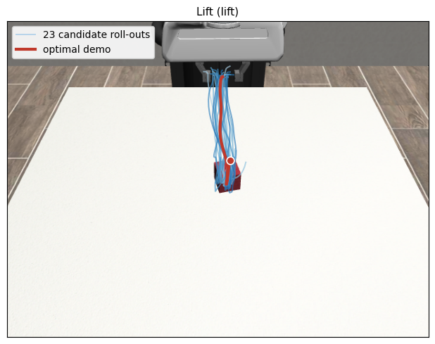 |
|  | 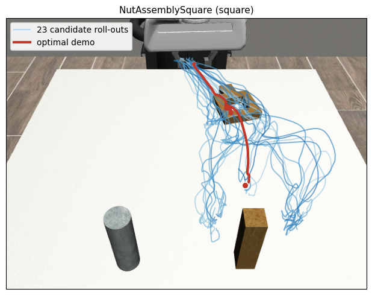 |

High-res PDFs: [headline_bar_crosstask.pdf](./figures/headline_bar_crosstask.pdf)
· [trajectory_on_env_lift.pdf](./figures/trajectory_on_env_lift.pdf)
· [trajectory_on_env_can.pdf](./figures/trajectory_on_env_can.pdf)
· [trajectory_on_env_square.pdf](./figures/trajectory_on_env_square.pdf)

**Call-out (right margin or footer):**

| Task | Best result | Wilson 95 % CI | n |
|---|---:|---|---:|
| Lift      | **100.0 %** (60/60)  | [94.0, 100.0] | 60  |
| Can/ph    | **73.8 %**  (177/240) | [67.8, 78.9]  | 240 |
| Square    | **50.0 %**  (15/30)   | [33.2, 66.8]  | 30  |

The green `Trained-DP + MBD` bars are a **reference**, not the
zero-training headline: Lift 60/60, Can 26/30 = 86.7 %, Square
5/60 = 8.3 % under the old Square operating point.

*Tool-hang and transport are intentionally omitted from this
panel: both ship with sparse-only rewards upstream; the
project-side dense-reward wrapper (`env_dense_rewards.py`,
commit `18af830`) is smoke-verified at mean +2.58 reward, but
the scored re-runs (Slate J) are pending and we don't yet have
an honest post-fix number.*

**Script (~70 s):**
> "Cross-task headline.  Lift: 60 / 60 — solved.  Can: 177 / 240
> in a 4-seed pool, CI 68 to 79 %.  The green bars are trained-DP
> reference cells: they improve Can to 86.7 %, but do not change the
> zero-training retrieval headline.  Square used to be the weak cell
> at H=120, but the June-7 diagnostic reaches 15 / 30 at H=300,
> λ=2.  Tool-hang and transport ship sparse-only rewards upstream;
> we omit them until there is an honest post-fix number."

---

## Slide 5b — Cost-vs-performance Pareto *(optional, 30 s)*

> Use this slide only if rehearsal time allows.  Drops in the
> "training cost" axis on top of the cross-task headline.

**Title bar:**
> Training cost vs final reward: retrieval is on the Pareto frontier

**Full-slide visual:**

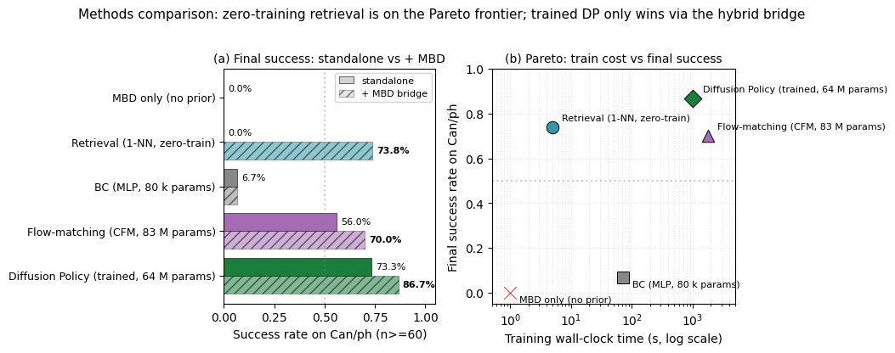

[high-res PDF](./figures/methods_comparison.pdf)

**Three-bullet takeaway:**
- **Retrieval (5 s, 73.8 %)** sits in the upper-left corner —
  zero training, near the trained-DP standalone.
- **Flow-matching (CFM) is *dominated*** — ~30 min of training for
  56 % standalone / 70 % +bridge, still below zero-train retrieval
  (73.8 %) at a fraction of the cost.  (The earlier EDM σ-specialist
  v3 was a true negative result — 0 %, excluded.)
- **Trained DP wins only via the hybrid bridge** — 17 min of GPU
  + the per-step MBD pull → 86.7 %.  Without the bridge, retrieval
  matches DP at 1/200 of the training cost.

**Script (~30 s):**
> "One slide on cost.  Retrieval at 5 seconds is Pareto-optimal.
> Flow-matching is dominated.  Trained DP only beats retrieval
> *with* the MBD bridge."

---

## Slide 6 — Two GREEN cells (80 s)

**Title bar:**
> MBD helps when the prior is coherent and has headroom

**Main visual:**

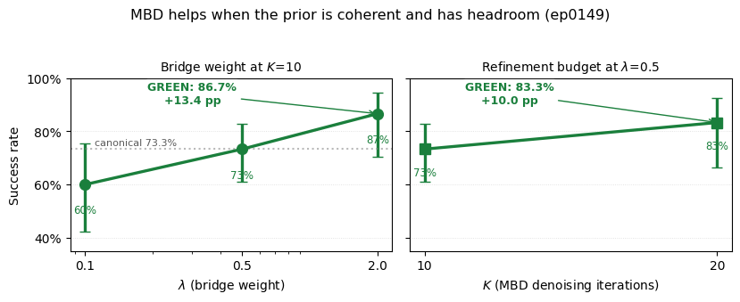

[high-res PDF](./figures/green_slices.pdf)

**Backup / Q&A only (do not put on the main slide unless asked):**

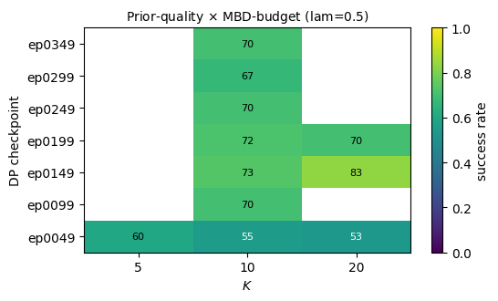

[high-res PDF](./figures/heatmap_ckpt_K.pdf)

**Exact ep0149 λ-monotone climb (Phase F):**

| λ | Cell | Wilson 95 % CI | Lift vs canonical (λ=0.5) |
|---|---|---|---:|
| 0.1 | 18 / 30 = 60.0 % | [42.3, 75.4] | −13.3 pp |
| 0.5 | 44 / 60 = 73.3 % | [61.0, 82.9] | (baseline) |
| 2.0 | **26 / 30 = 86.7 %** | [70.3, 94.7] | **+13.4 pp** GREEN |

K-knob lift at (ep0149, λ=0.5): K=10 → 73.3 %, **K=20 → 83.3 %**
(+10.0 pp, second GREEN cell).

**One-line summary (below the figure):**
> MBD lifts iff **(a)** prior score is informative *and*
> **(b)** prior has headroom — both conditions, neither alone.

**Script (~80 s):**
> "Where does the lift live?  Two knobs.  Left: at ep0149 — the
> moderate-prior peak — sweeping λ gives a monotone climb 60 to
> 73 to 87.  Same K=10 compute.  Right: doubling K gives a second
> GREEN cell at 83 %.  The heatmap is only backup: the main point
> is that the bridge helps when the prior is coherent and still
> has headroom."

---

## Slide 7 — Adaptation along two axes (60 s)

**Title bar:**
> Adaptation: coverage (bank size) and dynamics (perturbed mass)

**Two-panel layout (side-by-side):**

|  Coverage axis  |  Dynamics axis  |
|---|---|
| 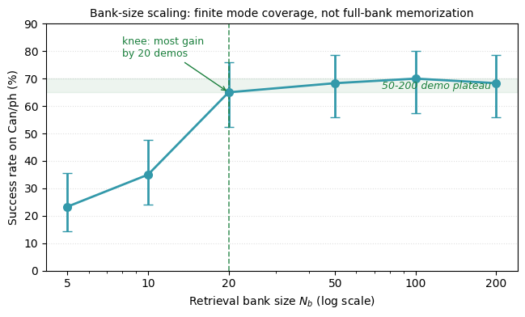 | 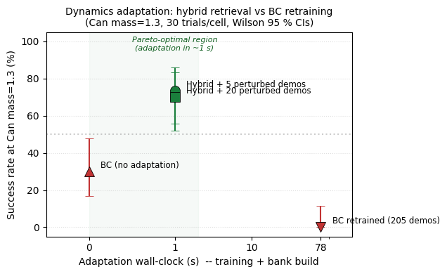 |

High-res PDFs:
[scaling_law.pdf](./figures/scaling_law.pdf) ·
[t2_pareto.pdf](./figures/t2_pareto.pdf)

**Third visual (small, below the two panels) — magnitude sweep:**

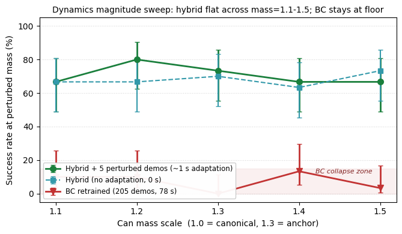

[high-res PDF](./figures/t2_magnitude.pdf)

**Three sub-stories, one line each:**
- **Coverage** -- bank N_b = 5 -> 200 saturates by N_b = 20-50.
  The full 200-demo bank is not a memorization artifact; most of
  the gain is finite mode coverage.
- **Dynamics (single point)** -- Adaptation Pareto at Can
  mass=1.3: hybrid + 5 perturbed demos = **73.3 % at 1 s**;
  BC retrained on the same 5 demos = **0 / 30** at 78 s.
  **78x speedup at non-inferior succ.**
- **Dynamics (magnitude sweep)** -- across mass=1.1 -> 1.5 the
  hybrid stays in **66.7 -- 80.0 %**; BC retraining is stuck in
  the **0 -- 13 %** floor band.  Gap is robust to magnitude
  within Can.

**Two exact tables (small fonts on slide; full versions in
[`SLIDE_SPEC.md`](./SLIDE_SPEC.md)):**

*Bank-size sweep on Can (June-7 bank-size slate, n=60/cell):*

| N_b |   5 |  10 |  20 |  50 | 100 | 200 |
|---:|---:|---:|---:|---:|---:|---:|
| succ | 23.3 % | 35.0 % | 65.0 % | 68.3 % | 70.0 % | 68.3 % |

*Magnitude sweep at Can (canonical aggregator JSON, N = 30 per
cell):*

| mass | Hybrid (no adaptation) | Hybrid + 5 perturbed demos | BC retrained (205) | gap |
|---:|---:|---:|---:|---:|
| 1.1 | 66.7 % | 66.7 % | 10.0 % | +56.7 pp |
| 1.2 | 66.7 % | 80.0 % | 10.0 % | +70.0 pp |
| 1.3 | 70.0 % | 73.3 % |  0.0 % | +73.3 pp |
| 1.4 | 63.3 % | 66.7 % | 13.3 % | +53.3 pp |
| 1.5 | 73.3 % | 66.7 % |  3.3 % | +63.3 pp |

**One-line headline (large, below all visuals):**
> Two axes, two saturations: coverage saturates by N_b = 20-50;
> dynamics adaptation gives a **78x Pareto speedup** over BC
> retraining across mass=1.1 -- 1.5.

**Script (~60 s):**
> "Two axes.  Left: bank size.  Three phases — under-coverage
> below twenty demos, then the knee at twenty demos, then a
> dead-flat plateau from fifty to two hundred.  This supports
> finite mode coverage rather than full-bank memorization.
> Right: dynamics.  Same hybrid, same MBD bridge, plus five
> demos collected under the perturbed dynamics.  Seventy-three
> percent in one second.  BC retraining on the same five demos
> takes seventy-eight seconds and gives zero out of thirty.
> And it is not a magnitude artefact — across mass 1.1 to 1.5
> the hybrid stays in the sixty-seven to eighty percent band;
> BC stays in the zero to thirteen percent floor."

---

## Slide 8 — Lessons + what didn't work (50 s)

**Title bar:**
> Lessons (advice we'd give a teammate starting tomorrow)

**Two-column layout, no main figure.**

**Things that helped (left column):**
- **Condition on small datasets; don't gradient-update on
  them.**  Five fresh demos broke our behavior-cloning
  baseline (0/30); the same five used as retrieval targets
  reached 73 %.  Tiny datasets carry too much variance for a
  gradient update to ignore.
- **Inside an iterative refinement loop, freeze your reference
  point.**  Letting the loop redefine its own anchor every step
  destabilises everything.  Locking it recovered the prior's
  standalone score (**+18 pp**) AND made results **~6× less
  seed-sensitive** — one change, two wins.
- **Always have a no-op sanity gate.**  Our most expensive
  single bug was two weeks of "method doesn't help" caused by
  a stray reset that fired even when the method was disabled
  (planner-only baseline: 0/50).  Adding the trivial guard:
  **8/10**.  *Run the trivial config first.*

**Things to watch for (right column):**
- **Falsify generalisation claims before publishing them.**  We
  assumed our retrieval bank captured "task-generic motion
  structure".  Cross-task tests: **≤ 5 %** every pair.  Test
  the strongest version of your generalisation claim — and walk
  it back if it fails.
- **A result needs headroom to be measurable.**  An effect can
  disappear when one task saturates the baseline at 100 % and
  another requires a longer-horizon operating point.  When
  transfer fails, ask whether the *room to observe* the effect
  exists at all — not just whether the method failed.
- **Sweep widely before calling a prior "general."**  A method
  that works in one narrow band can collapse two bands over.
  Specialist priors masquerade as general ones until you sweep.

**Script (~50 s):**
> "Three lessons worth sharing.  First: when you have a tiny new
> dataset, condition on it — don't retrain on it.  Five demos
> broke our supervised baseline; the same five used as
> retrieval targets gave the headline result.
> Second: inside any iterative refinement loop, freeze your
> reference point.  We let ours drift and lost both performance
> and seed-stability; locking it fixed both.
> Third: always have a no-op sanity gate — run the trivial config
> first.  Our most expensive bug was two weeks of 'method doesn't
> help' caused by a stray reset that fired even when the method
> was disabled."

---

## Slide 9 — Conclusions + Future work (40 s)

**Title bar:**
> Conclusions + future work

**Two-column layout, no main figure.**

**Conclusions (left column, 3 headline results):**
- **Cross-task:** Lift **100 %**, Can **73.8 %**.  Square is no
  longer a pure floor: `H=300, λ=2` reaches **50.0 %**.
- **Adaptation:** **78× speedup** over a retrained baseline
  (1 s vs 78 s, 5 demos; gap holds across 3 seeds and 5 mass
  scales 1.1 → 1.5).
- **Our analytical cost gradient is doing real work, not just
  decorating the prior.**  A pure-MBD-style inner loop (prior
  only, no cost term) caps below our headline Lift/Can numbers;
  the composite score — *prior + cost gradient* — is what
  closes the gap.  Slide 6's λ sweep is the direct evidence.

**Future work (right column, 4 next steps):**
- **Replicate and localize Square.**  Re-run `H=300, λ=2`,
  sweep nearby λ, and log failure phase.
- **Tool_hang / transport need subgoals or value signals.**
  More product/gate tuning is deprioritized.
- **Repeat adaptation under a trained-policy prior** — does
  the 78× story generalise beyond retrieval?
- **Turn bank-size saturation into a finite-coverage theory story.**

*(Drop FW item 4 first if time-trimmed.  GPU-accelerated
rollouts are infra-blocked on cloud-GPU quota and intentionally
off-slide.  Trained-policy 2-D grid is in INDEX.md.)*

**Bottom-of-slide (large, centered):**
> Thanks!  Questions?

**Script (~40 s):**
> "To wrap up.  Three results.  Cross-task: lift one hundred
> percent, can seventy-four percent; square is now partially
> unlocked at fifty percent.  Adaptation: seventy-eight
> times speedup over a retrained baseline — one second versus
> seventy-eight, held across three seeds and five mass scales.
> And the analytical cost gradient is doing real work, not just
> decorating the prior — with the cost term off, the inner loop
> caps below our headline numbers; turning it on closes the gap.
> Slide 6's lambda sweep is the direct evidence.
> Four next steps: replicate square, move tool-hang to subgoals
> or value signals, repeat under a trained-policy prior, and turn
> bank-size saturation into theory.  Thank you — questions?"

---

## Timing summary

| # | Slide | s | running |
|---|---|---:|---:|
| 1 | Title | 10 | 0:10 |
| 2 | Motivation | 45 | 0:55 |
| 3 | Problem | 50 | 1:45 |
| 4 | Method | 60 | 2:45 |
| 5 | Cross-task | 70 | 3:55 |
| 5b | Pareto *(optional)* | 30 | 4:25 |
| 6 | GREEN cells | 80 | 5:45 |
| 7 | Adaptation (two axes) | 60 | 6:45 |
| 8 | Lessons | 50 | 7:35 |
| 9 | Conclusions + Future | 40 | 8:15 |

**Without 5b (default 9-slide deck):** 7:45 total — 45 s over
the 7:00 hard stop (slide 9 absorbed +10 s for the conclusions
column; slide-7 expansion already landed earlier).
**With 5b:** 8:15 total.

**Trim recipes:**
- *9-slide deck → 7:00:* drop the slide-4 warm-start row (−15 s),
  the slide-6 inset heatmap + tighten script (−20 s), and the
  slide-8 third "things to watch for" bullet (−10 s).
- *10-slide deck → 7:00:* additionally drop the slide-7
  magnitude-sweep sub-panel (−15 s; table + speaker line still
  survive) and slide 9's FW item 4 + tighten its script (−10 s).

---

## Q&A prep (3 min)

1. **"How is this different from Diffusion Policy?"**
   DP is a pure prior; our composite score *adds* an analytical
   cost gradient.  Phase F's λ=2.0 GREEN at K=10 with DP-as-prior
   is the direct demonstration that the cost contributes.

2. **"Does Square work now?"**
   Partially.  At the old H=120 operating point it was near zero,
   but H=300 λ=2 reaches 50 %.  Horizon alone is not enough; next
   step is replication and failure-phase logging.

3. **"Where did the safety / CBF angle go?"**
   Scoped out per Week-5 reviewer.  Binary-success comparison is
   the single load-bearing claim now.

4. **"How sensitive to λ?"**
   At ep0149: monotone in λ over {0.1, 0.5, 2.0}.  Elsewhere:
   flat.  Sensitivity is prior-quality-dependent.

5. **"Compute?"**
   Full Phase-D grid (Q1 + Q2 + Q3 + E + F) on a single Mac via
   four chained slates + disjoint seed bands.  GCP arm was
   killed mid-run by an orphan-worker bug.

6. **"What's the theoretical claim?"**
   No formal claim yet — the empirical "both conditions
   required" reading is the headline.  Pareto bias-variance
   analysis is the planned theoretical companion
   (`feat/adapt-pareto-analysis`).

---

## Build commands

All commands assume you're at the repo root
(`cd Hybrid-Robot-Trajectory-Generation`) and have the
`hybrid-traj` conda env active.  Total wall ≈ 3 min.

```bash
PY="$HOME/anaconda3/envs/hybrid-traj/bin/python"

# (a) 6 headline charts + 1 method-architecture schematic
$PY -m presentation.scripts.make_headline_figures --plot all

# (b) 5 trajectory-on-env ensemble PDFs + 5 MP4s
$PY -m presentation.scripts.render_trajectory_on_env --task all

# (c) 5 best-rollout MP4s (action-replay for the short tasks,
#     state-replay for tool_hang / transport)
$PY -m presentation.scripts.render_best_rollout --task lift
$PY -m presentation.scripts.render_best_rollout --task can
$PY -m presentation.scripts.render_best_rollout --task square
$PY -m presentation.scripts.render_best_rollout --task tool_hang --mode state
$PY -m presentation.scripts.render_best_rollout --task transport --mode state
```

Scripts live in [`./scripts/`](./scripts/), with their own
[README](./scripts/README.md).

---

## Style guide

| Role | Hex | Used for |
|---|---|---|
| Neutral grey | `#888888` | BC bars |
| Red    | `#c23333` | MBD-alone bars |
| Blue   | `#3399aa` | Retrieval bars |
| Green  | `#1a7f3c` | Hybrid / GREEN cells |
| Optimal demo (in trajectory plots) | `#c0392b` | every red trajectory line |
| Candidate cloud (in trajectory plots) | `Blues` cmap | every faded-blue trajectory cloud |

Render equations via LaTeXiT or MathJax — **not** matplotlib
`mathtext` (we hit kerning issues with the displayed math).

---

## Pre-flight checklist

- [ ] All 7 headline PDFs open and are vector (no rasterisation).
- [ ] All 10 MP4s play in the slide tool (Keynote: drag & drop,
      autoplay & loop both on for the motivation panel).
- [ ] First sentence of the talk rehearsed without notes.
- [ ] Full run-through under a stopwatch — target ≤ 6:30 if 9
      slides, ≤ 7:05 if Slide 5b is included.
- [ ] Backup PDF export of every slide on a thumb drive.
- [ ] Demo of one MP4 on the projector hardware before going on.

---

## Related documents in this folder

- [`README.md`](./README.md) — folder overview and headline narrative.
- [`INDEX.md`](./INDEX.md) — asset inventory: every file with its
  absolute path, source script, and source data.
- [`SLIDE_SPEC.md`](./SLIDE_SPEC.md) — same content as this guide,
  but without inline image previews and with more verbose
  commentary (kept as a backup reference).
- [`OUTLINE.md`](./OUTLINE.md) — verbatim speaking script
  (slightly longer than the ≤ 50-word per-slide scripts above).
- [`ASSETS.md`](./ASSETS.md) — earliest inventory, superseded by
  INDEX.md.  Kept for git-archaeology only.
